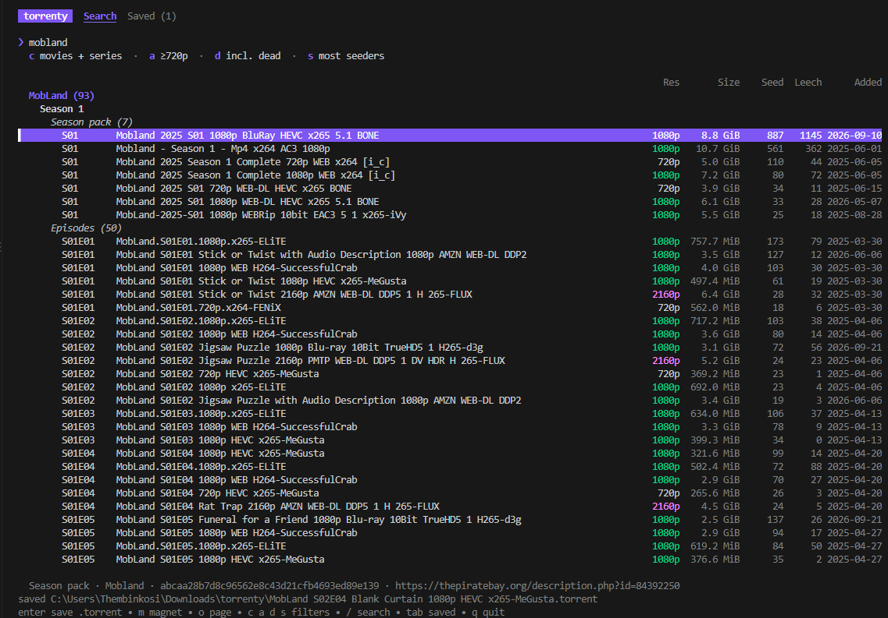

<div align="center">


# torrenty

**A tiny terminal UI for finding movies and series and saving their `.torrent` files.**

[](https://github.com/ThembinkosiThemba/torrenty/releases/latest)
[](https://github.com/ThembinkosiThemba/torrenty/actions/workflows/release.yml)
[](go.mod)
[](#install)
[](LICENSE)

[Install](#install) · [Usage](#usage) · [Keys](#keys) · [Building](#building-from-source) · [Contributing](#contributing)



</div>

## Features

- **Movies and series only.** Searches cover video categories only. Music, images, clips and NSFW results are filtered out.
- **Smart series grouping.** Results are grouped by show, then by multi-season packs, season packs and episodes. Episodes are listed in episode order.
- **Quality filter.** Anything below 720p is hidden by default, and so are dead torrents (0 seeders).
- **Smallest first.** Each group starts with the smallest torrent. You can switch to most seeders or newest.
- **Focused download screen.** Choosing a torrent shows only that torrent while its `.torrent` file is fetched.
- **Persistent history.** Saved torrents are remembered between sessions. If you save one you already have, torrenty asks before replacing it.
- **Open anywhere.** You can send a magnet link straight to your torrent app or open the torrent's web page.

## Install

### Prebuilt binaries

Download the archive for your platform from the [latest release](https://github.com/ThembinkosiThemba/torrenty/releases/latest).

| Platform | Archive |
|----------|---------|
| Windows x64 / ARM64 | `torrenty-<version>-windows-amd64.zip` / `-arm64.zip` |
| Linux x64 / ARM64 | `torrenty-<version>-linux-amd64.tar.gz` / `-arm64.tar.gz` |

- **Windows:** unzip it and double-click `torrenty.exe`. It opens in a terminal window.
- **Linux:** extract it and run `./install.sh`. This installs `torrenty` to `~/.local/bin` and adds it, with its icon, to your app menu. Launched from the menu, it opens in a terminal.

### Requirements

torrenty uses [aria2](https://aria2.github.io/) (`aria2c`) to turn magnet links into `.torrent` files:

```sh
winget install aria2.aria2      # Windows
sudo apt install aria2          # Debian/Ubuntu
sudo dnf install aria2          # Fedora
```

Without aria2 you can still search and send magnet links to your torrent app.

## Usage

```sh
torrenty                  # save .torrent files to ~/Downloads/torrenty
torrenty -dir D:/Torrents # save them somewhere else
```

| Flag   | Default                | Description                      |
|--------|------------------------|----------------------------------|
| `-dir` | `~/Downloads/torrenty` | Where `.torrent` files are saved |

Saved-torrent history is kept in your config directory: `%AppData%\torrenty\history.json` on Windows, `~/.config/torrenty/history.json` on Linux.

## Keys

**Search**

| Key | Action |
|-----|--------|
| `enter` | Search (in the box) / save `.torrent` (on a result) |
| `↑/↓`, `pgup/pgdn`, `g/G` | Move through the results |
| `m` | Open the magnet link in your torrent app |
| `o` | Open the torrent's web page |
| `c` | Switch type: movies + series / movies / series |
| `a` | Toggle quality: ≥720p / any |
| `d` | Toggle dead torrents |
| `s` | Switch sort: smallest / most seeders / newest |
| `/` | Back to the search box |
| `tab` | Go to the Saved tab |
| mouse | Click a row to select it, click it again to save; the wheel scrolls |

**Download screen**

| Key | Action |
|-----|--------|
| `enter` | Open the saved `.torrent` |
| `r` | Replace an existing file or retry a failed fetch |
| `f` | Open the download folder |
| `esc` | Go back (a fetch keeps running in the background) |

**Saved:** `enter` shows details, `x` removes the entry from the history, `f` opens the folder.

## Building from source

You need Go 1.26 or newer.

```sh
git clone https://github.com/ThembinkosiThemba/torrenty.git
cd torrenty
go run ./cmd/torrenty                       # run
go build -o torrenty.exe ./cmd/torrenty     # build
```

On Windows, `packaging/windows/install.ps1` builds torrenty and installs it to `%LOCALAPPDATA%\Programs\torrenty`. It also adds that folder to your PATH and creates a Start Menu shortcut. It rebuilds only when the source has changed; pass `-Force` to always rebuild.

### Project layout

```
cmd/torrenty/      entry point: flags only
internal/          one flat package
  run.go           starts the TUI
  result.go        Result type and Provider interface
  apibay.go        search provider
  classify.go      release-name parsing: kind, season/episode, resolution
  group.go         filters, sorting and grouping into list rows
  fetch.go         magnet → .torrent via aria2c
  history.go       saved-torrent history (JSON)
  open.go          opens links, files and folders with the OS
  ui.go, view.go   Bubble Tea state and rendering
packaging/         icon, Linux and Windows install scripts
docs/              screenshots
```

### Releases

Every push and pull request is built for Windows and Linux (amd64 and arm64) by [GitHub Actions](.github/workflows/release.yml). To publish a release, push a version tag:

```sh
git tag v0.1.0
git push --tags
```

The workflow attaches the archives to a GitHub Release with notes generated automatically.

## Contributing

Issues and pull requests are welcome. torrenty is small on purpose, so prefer the simplest change. Before opening a PR:

```sh
gofmt -w .
go vet ./...
```

See [AGENTS.md](AGENTS.md) for the architecture and project rules.

## Disclaimer

torrenty searches a public index and saves `.torrent` metadata. It does not host or download any content itself. You are responsible for making sure that what you download is legal where you live.

## License

[MIT](LICENSE) © 2026 ThembinkosiThemba
